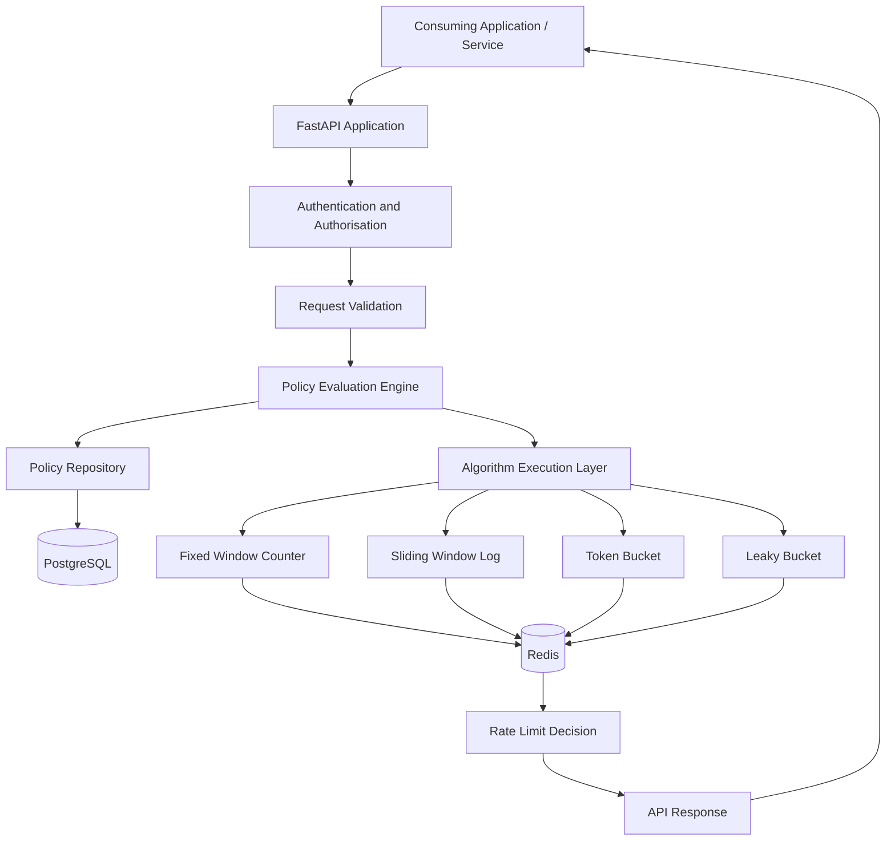
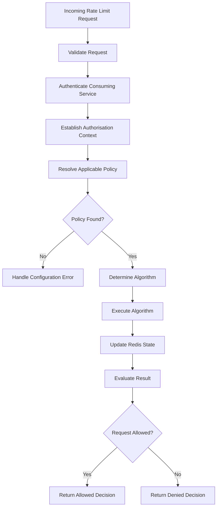
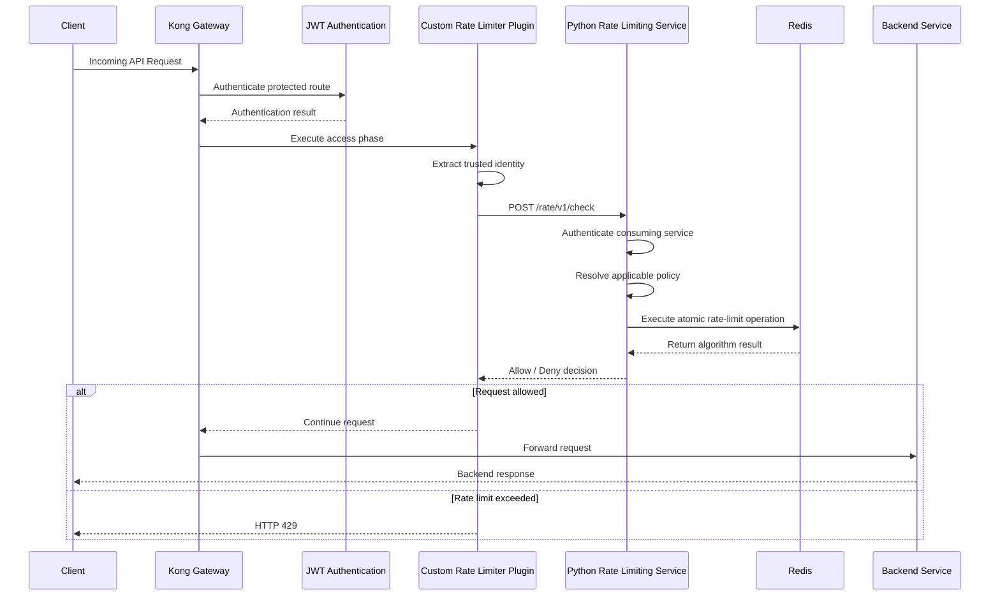

# rate-limiting-service
# Rate Limiting Microservice

<p align="center">
  <strong>An Independent, Policy-Driven Rate Limiting Service for Distributed Applications</strong>
</p>

<p align="center">
  A reusable Python/FastAPI microservice designed to centralise request-rate enforcement, manage configurable policies, and provide concurrency-safe rate-limit evaluation using Redis.
</p>

<p align="center">
  <a href="https://github.com/namankali/rate-limiting-service">GitHub Repository</a>
</p>

---

## 1. Overview

The **Rate Limiting Microservice** is an independently developed backend service designed to provide centralised, policy-driven rate limiting for distributed applications.

In distributed systems, individual applications often implement rate-limiting logic independently. This can introduce duplicated functionality, inconsistent enforcement, tightly coupled infrastructure, and difficulties managing request quotas across multiple services.

This project addresses that problem by separating rate-limiting responsibilities into a dedicated microservice.

Applications can delegate rate-limit evaluation to this service through an authenticated API. The service resolves the applicable policy, executes the configured rate-limiting algorithm, maintains request state using Redis, and returns a decision indicating whether the incoming request should be allowed or rejected.

The architecture is designed to be reusable across multiple applications without requiring each application to implement its own rate-limiting engine.

### Key Objectives

- Build an independent and reusable rate-limiting microservice.
- Centralise rate-limiting policy management and enforcement.
- Support multiple rate-limiting algorithms for different traffic patterns.
- Maintain distributed request state using Redis.
- Ensure concurrency-safe request evaluation through atomic Redis operations.
- Persist policy and service-related information using PostgreSQL.
- Provide authenticated service-to-service communication.
- Support integration with API gateways and distributed backend applications.
- Containerise and deploy the service in a Kubernetes environment.

---

## 2. Technology Stack

| Category | Technologies |
|---|---|
| Language | Python |
| Backend Framework | FastAPI |
| Data Validation | Pydantic |
| ORM | SQLAlchemy |
| Relational Database | PostgreSQL |
| Database Hosting | NeonDB |
| Distributed State and Caching | Redis |
| Atomic Operations | Redis Lua Scripts |
| Testing | pytest |
| Static Type Checking | Mypy |
| Linting and Formatting | Ruff |
| Git Hooks | pre-commit |
| Database Migrations | Alembic |
| Containerisation | Docker |
| Orchestration | Kubernetes / K3s |
| API Gateway Integration | Kong Gateway |
| Load Testing | Locust |
| Monitoring and Visualisation | Prometheus and Grafana |

---

## 3. System Architecture

The service follows a modular architecture that separates API handling, authentication, policy evaluation, algorithm execution, and data persistence.

### High-Level Architecture



### Component Responsibilities

| Component | Responsibility |
|---|---|
| FastAPI Application | Exposes the service API and coordinates request processing. |
| Authentication and Authorisation | Validates consuming service credentials and establishes the caller's authorisation context. |
| Request Validation | Validates incoming request data and expected parameters. |
| Policy Evaluation Engine | Determines the applicable rate-limiting policy. |
| Algorithm Execution Layer | Executes the algorithm selected by the policy. |
| PostgreSQL | Persists service, permission, and policy-related information. |
| Redis | Maintains request state required by the rate-limiting algorithms. |
| Redis Lua Scripts | Execute related Redis operations atomically where implemented. |
| API Response | Returns the rate-limiting decision to the consuming application. |

---

## 4. Rate-Limiting Algorithms

The service supports multiple rate-limiting algorithms to accommodate different traffic patterns and enforcement requirements.

### 4.1 Fixed Window Counter

Maintains a request counter for a defined time interval. Each request increments the counter associated with the current window.

**Characteristics:**
- Simple counter-based implementation.
- Low memory overhead.
- Efficient request evaluation.
- Can allow bursts around window boundaries.

### 4.2 Sliding Window Log

Tracks request timestamps within a rolling time interval. Expired timestamps are removed before evaluating the remaining request count.

**Characteristics:**
- Precise rolling-window enforcement.
- Avoids fixed-window boundary bursts.
- Requires maintaining request timestamp state.
- Higher storage and processing overhead than a simple counter.

### 4.3 Token Bucket

Maintains a configurable number of tokens that replenish over time. Each accepted request consumes a token.

**Characteristics:**
- Supports controlled traffic bursts.
- Configurable token replenishment.
- Suitable for variable traffic patterns.
- Requires maintaining token and timing state.

### 4.4 Leaky Bucket

Models incoming traffic as a queue processed at a controlled rate.

**Characteristics:**
- Helps regulate traffic bursts.
- Provides controlled request processing.
- Useful for smoothing incoming traffic.
- Requires maintaining queue-related state.

### Algorithm Comparison

| Algorithm | State maintained | Main advantage | Main trade-off |
|---|---|---|---|
| Fixed Window | Counter and window information | Simplicity and efficiency | Boundary bursts |
| Sliding Window Log | Request timestamps | Precise rolling-window enforcement | Storage overhead |
| Token Bucket | Token count and timing state | Controlled burst allowance | Replenishment calculations |
| Leaky Bucket | Queue and timing state | Traffic smoothing | Queue management |

---

## 5. Policy-Driven Rate Limiting

The service uses a policy-driven enforcement model.

Instead of hardcoding rate limits into individual API endpoints, the policy engine determines the applicable configuration for an incoming request.

Policy evaluation considers attributes such as:

- Resource
- Route
- HTTP method
- Identity type
- Identity value
- Consuming service identity

The selected policy determines the applicable rate-limiting configuration and algorithm.

### Policy Evaluation Flow



---

## 6. Redis and Atomic Operations

Redis maintains the state required by the rate-limiting algorithms.

In a concurrent environment, multiple requests can arrive almost simultaneously and attempt to modify the same rate-limit state.

Without appropriate synchronisation, this can introduce race conditions and incorrect quota enforcement.

Redis Lua scripts allow related Redis operations to execute atomically, preventing other Redis commands from interleaving during script execution.

This is particularly important for operations involving:

- Reading current request state.
- Checking configured limits.
- Updating counters or algorithm state.
- Evaluating whether a request should be accepted.

---

## 7. Authentication and Service Authorisation

The microservice provides authentication for consuming applications and services.

Service credentials consist of:

- Credential ID
- Credential secret

The credentials are supplied through Bearer authentication.

The service authenticates the calling service and establishes an authorisation context that can be used during policy evaluation.

The database maintains service and permission relationships, with foreign-key constraints and a composite uniqueness constraint on the service-permission association.

Sensitive credentials should be managed through environment configuration and Kubernetes Secrets rather than hardcoded into application source code.

---

## 8. API Reference

### Rate Limit Evaluation

| Property | Value |
|---|---|
| HTTP Method | POST |
| Endpoint | `/rate/v1/check` |
| Authentication | Bearer service credentials |
| Purpose | Evaluate an incoming request against its applicable rate-limiting policy |

### Response Fields

| Field | Description |
|---|---|
| `allowed` | Indicates whether the request is permitted. |
| `policy` | Identifies the applied policy when provided. |
| `limit` | Configured request limit when provided. |
| `remaining` | Remaining request allowance when provided. |
| `retry_after` | Retry delay when provided. |

The API uses structured request and response validation through Pydantic.

---

## 9. Database Design

PostgreSQL is used for persistent application and policy-related information.

SQLAlchemy provides the ORM layer and supports asynchronous database interaction.

The service-permission association uses a composite uniqueness constraint on:

```text
(service_identity_id, permission_id)
```

This prevents the same permission from being assigned multiple times to the same service identity.

| PostgreSQL | Redis |
|---|---|
| Persistent application data | Dynamic rate-limit state |
| Service and permission relationships | Request counters and algorithm state |
| Policy-related information | Time-sensitive enforcement operations |
| Relational integrity | Atomic state transitions |

---

## 10. Containerisation and Kubernetes

The microservice is containerised using Docker and deployed in a Kubernetes environment.

Infrastructure components include:

- Docker container images.
- Kubernetes Deployments.
- Kubernetes Services.
- Namespace-based workload separation.
- Environment-based configuration.
- Kubernetes Secrets.
- Redis connectivity.
- PostgreSQL connectivity.

The service operates as an independent workload rather than being embedded into the consuming application's deployment.

---

## 11. Kong API Gateway Integration

The service is designed to integrate with Kong Gateway through a custom Lua plugin.

The objective is to delegate rate-limit evaluation to the independent Python service while allowing Kong to remain responsible for API gateway responsibilities.

### Intended Request Flow



The intended integration includes:

- JWT authentication before rate-limit evaluation on protected routes.
- Trusted identity extraction.
- IP-based identity for applicable public routes.
- Service-to-service authentication.
- Dynamic resource, route, and HTTP method extraction.
- Centralised policy evaluation.
- HTTP 429 enforcement.
- Configurable failure handling.

**Integration status:** Custom Kong plugin development and end-to-end integration are in progress.

---

# 12. Development Environment Setup

This section contains the commands required to resume development or onboard another contributor.

## 12.1 Prerequisites

Install the following:

- Python 3.14.3 (or the project's configured Python version).
- pip.
- Redis.
- PostgreSQL or a configured PostgreSQL-compatible database.
- Docker.
- Git.
- Ruff.
- Mypy.
- Alembic.
- pre-commit.

The development environment must have access to the configured Redis and PostgreSQL instances.

## 12.2 Clone the Repository

```bash
git clone https://github.com/namankali/rate-limiting-service.git

cd rate-limiting-service
```

## 12.3 Create a Virtual Environment

```bash
python3 -m venv .venv
```

Activate the virtual environment.

**macOS / Linux:**

```bash
source .venv/bin/activate
```

Install the dependencies:

```bash
pip install -r requirements.txt
```

Install development dependencies:

```bash
pip install -r requirements-dev.txt
```

## 12.4 Configure Environment Variables

Configure the required application settings, including:

- PostgreSQL connection details.
- Redis connection details.
- Authentication configuration.
- Application configuration.

Use the project's environment configuration as the source of truth.

**Important:** Never commit actual credentials, private keys, database passwords, or other secrets to Git.

---

# 13. Development Command Reference

A quick reference for frequently used development commands.

## 13.1 Start the FastAPI Application

Run the application locally:

```bash
python3 -m uvicorn app.main:app --reload --port 8002
```

The application will be available at:

```text
http://localhost:8002
```

The `--reload` option automatically restarts the development server when source files change.

## 13.2 Ruff — Linting and Formatting

### Check the entire project for linting issues

```bash
ruff check .
```

### Check formatting without modifying files

```bash
ruff format --check .
```

The `--check` option reports formatting differences without changing source files.

To apply formatting when necessary:

```bash
ruff format .
```

## 13.3 Mypy — Static Type Checking

Run Mypy:

```bash
mypy
```

Mypy checks the project for static typing issues based on the configured `pyproject.toml`.

## 13.4 pre-commit — Configuration Validation

Validate the `.pre-commit-config.yaml` file:

```bash
pre-commit validate-config
```

This checks whether the pre-commit configuration is valid.

If the repository's pre-commit hooks are installed, run them across all tracked files using:

```bash
pre-commit run --all-files
```

## 13.5 Database Migrations — Alembic

The project uses Alembic to manage database schema changes.

**Step 1: Generate a migration**

After modifying SQLAlchemy models:

```bash
alembic revision --autogenerate -m "describe_your_changes"
```

Example:

```bash
alembic revision --autogenerate -m "add_service_permissions_constraint"
```

Review the generated migration before applying it. Autogeneration does not guarantee that every database change has been detected correctly.

**Step 2: Apply migrations**

```bash
alembic upgrade head
```

This applies all pending migrations.

**Step 3: Verify the current migration revision**

```bash
alembic current
```

This displays the current revision applied to the database.

**Useful additional migration commands**

Display migration history:

```bash
alembic history
```

Display the current database revision:

```bash
alembic current
```

Generate an empty migration when manual migration operations are needed:

```bash
alembic revision -m "describe_your_changes"
```

**Migration best practices:**

- Always review autogenerated migration files.
- Never modify an already-applied migration casually.
- Include both upgrade and downgrade operations where appropriate.
- Verify migrations against the intended database.
- Avoid destructive schema changes without checking their impact on existing data.
- Keep migration files committed to version control.

## 13.6 Delete a Virtual Environment

To remove the development virtual environment:

```bash
rm -rf .venv-clean
```

To remove the standard project virtual environment instead:

```bash
rm -rf .venv
```

Recreate it using:

```bash
python3 -m venv .venv
```

Activate it and reinstall the dependencies afterwards.

## 13.7 Docker — Build the Image

Build the Docker image for the ARM64 platform:

```bash
docker build --platform linux/arm64 -t rate-limiting-service:latest .
```

This is useful when building an image for an ARM64 deployment environment.

Inspect the resulting image:

```bash
docker images rate-limiting-service
```

For a different deployment architecture, change the `--platform` argument accordingly.

---

# 14. Testing and Code Quality

The project uses automated testing and static analysis to improve correctness and maintainability.

### Run pytest

```bash
pytest
```

Run tests with verbose output:

```bash
pytest -v
```

### Run Ruff

```bash
ruff check .
ruff format --check .
```

### Run Mypy

```bash
mypy
```

### Run pre-commit

```bash
pre-commit validate-config
pre-commit run --all-files
```

The testing strategy focuses on:

- Algorithm correctness.
- Request-limit enforcement.
- Boundary conditions.
- Concurrent request handling.
- Redis state consistency.
- Service authentication and validation.
- Error handling.

---

# 15. Testing and Observability Roadmap

The project is designed to expand its testing and observability capabilities.

### Locust — Load Testing

Locust will be used to simulate concurrent clients and generate different traffic patterns.

Planned scenarios include:

- Normal request traffic.
- Concurrent requests from multiple identities.
- Sudden traffic bursts.
- Sustained traffic.
- Requests approaching configured rate limits.
- Gateway-level traffic evaluation.

### Prometheus and Grafana — Monitoring

Prometheus and Grafana are intended to support observability and performance analysis.

Potential monitoring areas include:

- Request throughput.
- Response latency.
- HTTP status code distribution.
- Rate-limit decisions.
- Application resource utilisation.
- Redis performance.

These tools should be marked as implemented only once their integration is operational.

---

# 16. Project Structure

The following is a conceptual structure. Refer to the actual repository for the authoritative directory layout.

```text
rate-limiting-service/
│
├── app/
│   ├── api/
│   ├── algorithms/
│   ├── core/
│   ├── db/
│   ├── models/
│   ├── repositories/
│   ├── schemas/
│   ├── services/
│   └── main.py
│
├── tests/
│
├── migrations/
│
├── requirements.txt
├── requirements-dev.txt
├── pyproject.toml
├── .pre-commit-config.yaml
├── Dockerfile
├── .dockerignore
└── README.md
```

---

# 17. Project Status

| Feature | Status |
|---|---|
| FastAPI microservice foundation | Implemented |
| Fixed Window Counter | Implemented |
| Sliding Window Log | Implemented |
| Token Bucket | Implemented |
| Leaky Bucket | Implemented |
| Redis integration | Implemented |
| Redis Lua atomic operations | Implemented |
| PostgreSQL integration | Implemented |
| Service authentication and authorisation | Implemented |
| Policy-driven evaluation | Under active development |
| Docker containerisation | Implemented |
| Kubernetes deployment | Implemented |
| Kong custom Lua plugin | In progress |
| End-to-end Kong integration | In progress |
| Expanded Locust load testing | Planned |
| Prometheus and Grafana observability | Planned |

Update these statuses as features are completed and verified.

---

# 18. Engineering Considerations

This project explores several important backend and distributed-systems concepts:

**Separation of concerns**

Rate-limit enforcement is implemented as an independent service rather than being tightly coupled to consuming applications.

**Concurrency and atomicity**

Redis Lua scripts support atomic state transitions for critical rate-limiting operations.

**Policy-driven architecture**

Rate-limiting behaviour is determined by policy configuration rather than being hardcoded into individual application routes.

**Algorithmic trade-offs**

Different algorithms provide different behaviours in terms of burst handling, memory requirements, precision, and traffic control.

**Service authentication**

Consuming applications authenticate using service credentials, allowing the rate-limiting service to establish the caller's identity and authorisation context.

**Infrastructure integration**

The service is designed to operate within Kubernetes and integrate with an API gateway while retaining its independent application boundary.

---

# 19. Future Engineering Work

The intended development direction includes:

- Completing the custom Kong Gateway plugin.
- Validating end-to-end gateway-to-service communication.
- Expanding automated concurrency testing.
- Implementing Locust-based load-testing scenarios.
- Measuring throughput and latency under different workloads.
- Integrating Prometheus metrics and Grafana dashboards.
- Evaluating service behaviour during dependency failures.
- Documenting performance characteristics and architectural trade-offs.

---

# 20. Contributing

Contributions, bug reports, and architectural suggestions are welcome.

If you want to contribute:

1. Fork the repository.
2. Clone your fork.
3. Create a feature branch.
4. Set up the development environment.
5. Implement your changes.
6. Add or update relevant tests.
7. Run linting, formatting, and type checks.
8. Verify database migrations if applicable.
9. Submit a pull request with a clear description of your changes.

Before submitting changes, run:

```bash
ruff check .
ruff format --check .
mypy
pytest
pre-commit validate-config
```

Please ensure that sensitive credentials and environment-specific configuration are not committed.

---

## Author

**Naman Mahna**

Software Engineer | Backend Engineering | Distributed Systems | Cloud-Native Development

GitHub: [namankali](https://github.com/namankali)

Repository: [rate-limiting-service](https://github.com/namankali/rate-limiting-service)

---

<p align="center">
  <strong>Building reliable infrastructure, one engineering decision at a time.</strong>
</p>
